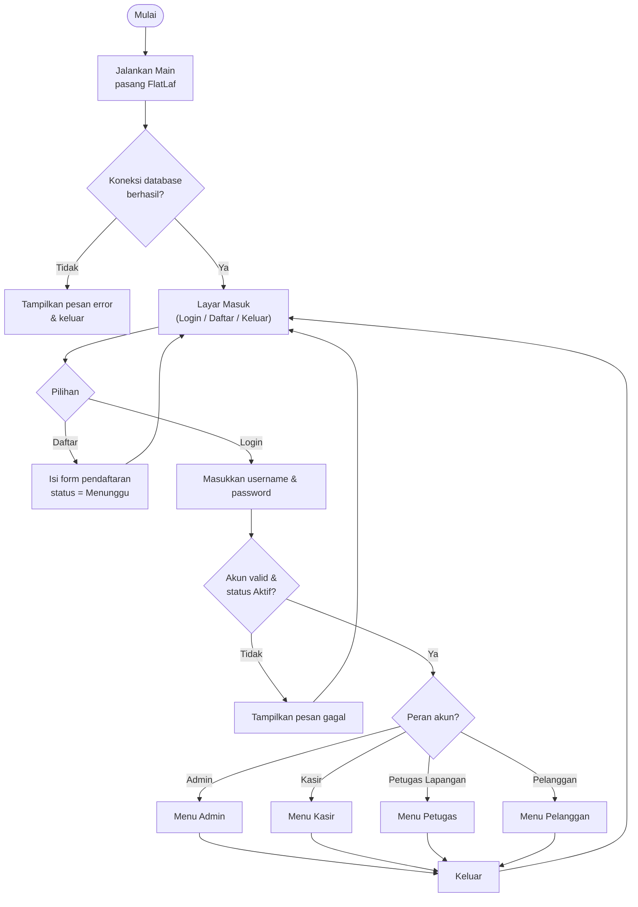
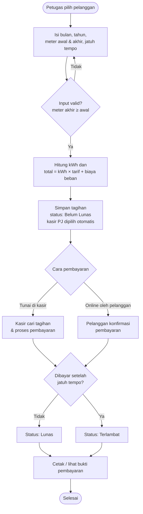
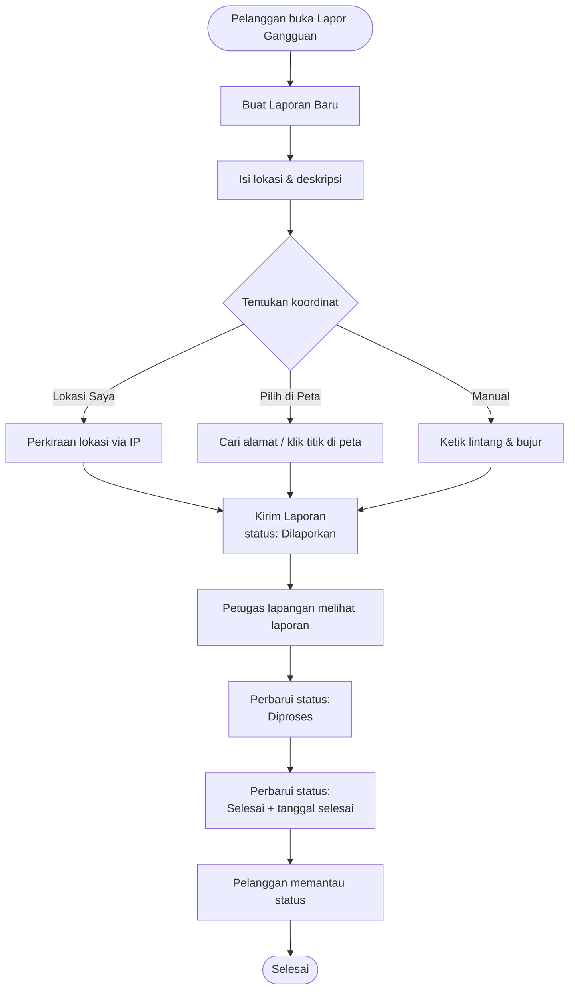
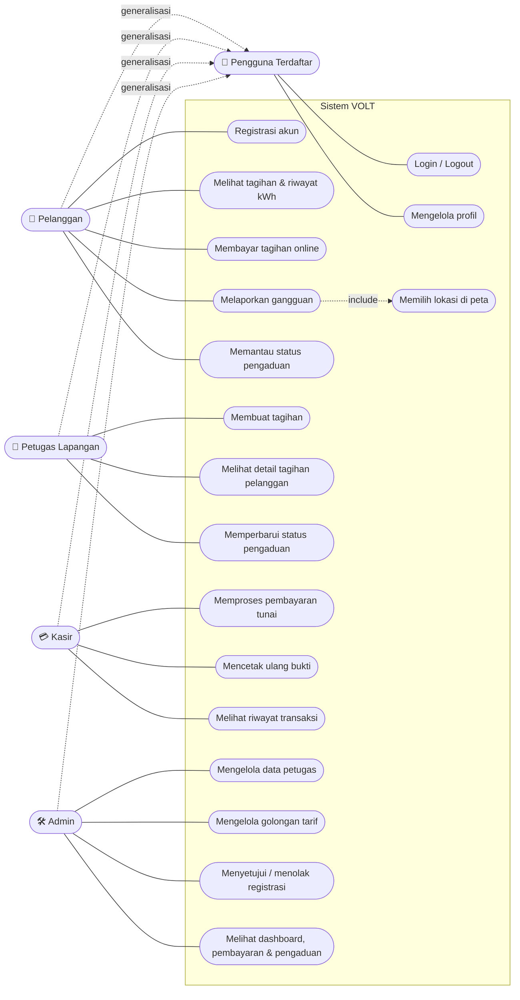
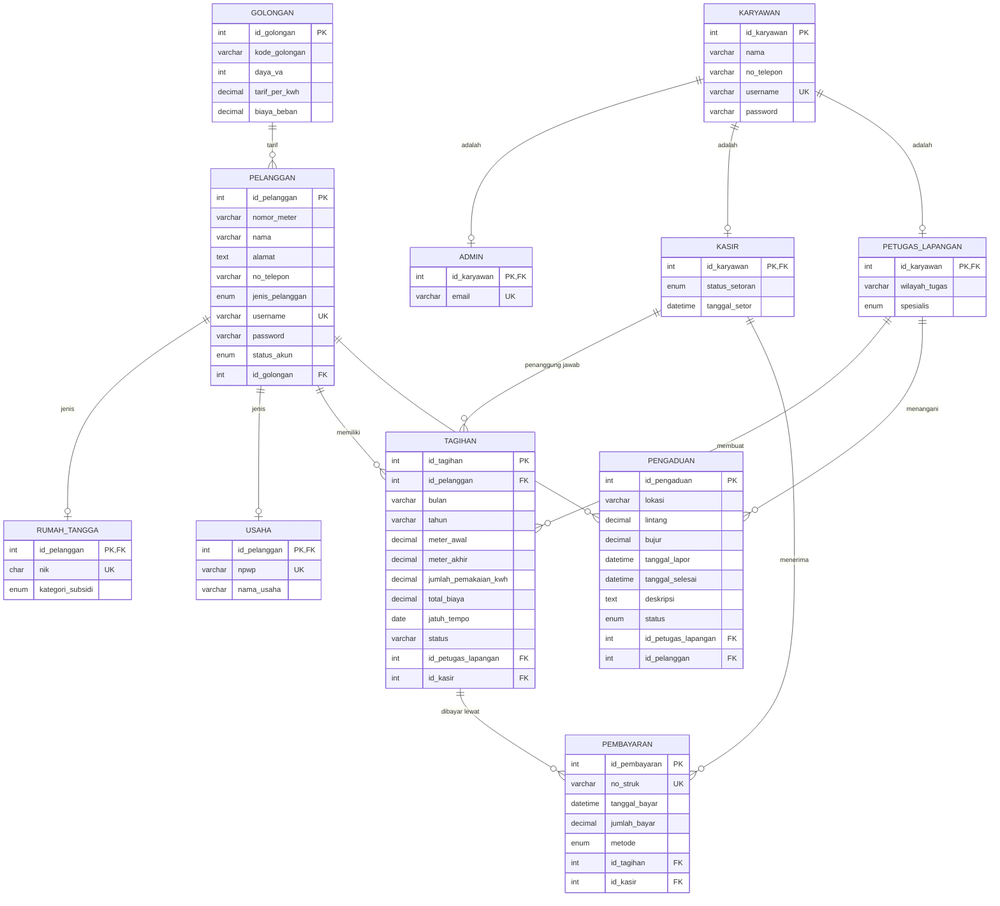
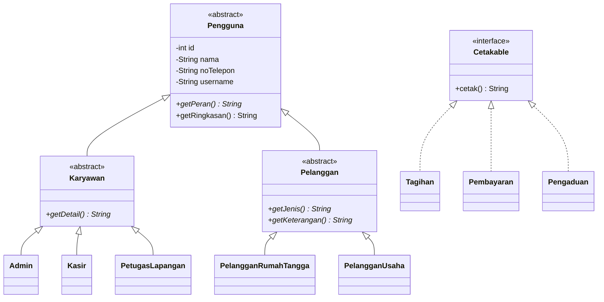

# VOLT — Sistem Tagihan Listrik & Pengaduan Gangguan

> Aplikasi desktop berbasis **Java Swing + MySQL** dengan arsitektur **MVC** untuk mengelola tagihan listrik, pembayaran, dan pengaduan gangguan pelanggan.

---

## Daftar Isi
1. [Nama Program](#1-nama-program)
2. [Deskripsi Singkat](#2-deskripsi-singkat)
3. [Fitur Utama Program](#3-fitur-utama-program)
4. [Tech Stack](#4-tech-stack)
5. [Perancangan Sistem](#5-perancangan-sistem)
6. [Struktur Folder / Package](#6-struktur-folder--package)
7. [Penerapan 4 Pilar OOP](#7-penerapan-4-pilar-oop)
8. [Cara Penggunaan Program](#8-cara-penggunaan-program)
9. [Kontributor](#9-kontributor)

---

## 1. Nama Program

**VOLT** — Sistem Tagihan Listrik & Pengaduan Gangguan (Samarinda).

---

## 2. Deskripsi Singkat

VOLT membantu penyedia layanan listrik mengelola proses dari ujung ke ujung dalam satu aplikasi:
petugas lapangan mencatat meter dan membuat tagihan, pelanggan melihat dan membayar tagihan, kasir memproses pembayaran tunai,
dan admin mengelola data master serta memantau statistik. Pelanggan juga dapat melaporkan gangguan listrik (lengkap dengan koordinat lokasi
yang bisa dipilih di peta), lalu petugas lapangan memperbarui status penanganannya.

Aplikasi memiliki **4 peran**: **Admin**, **Kasir**, **Petugas Lapangan**, dan **Pelanggan** (Rumah Tangga / Usaha). Menu yang tampil mengikuti peran akun yang login.

---

## 3. Fitur Utama Program

| Peran | Fitur |
|---|---|
| **Umum** | Login berbasis peran • Pendaftaran pelanggan baru (status *Menunggu* sampai disetujui admin) • Pencarian langsung di semua tabel • Profil akun |
| **Admin** | Dashboard statistik (kartu angka + tabel rincian) • CRUD data petugas (Kasir / Petugas Lapangan) & status setoran kasir • CRUD golongan tarif • Persetujuan / penolakan registrasi pelanggan • Riwayat pembayaran • Laporan pengaduan |
| **Petugas Lapangan** | Membuat tagihan (kWh & total biaya dihitung otomatis dari tarif + biaya beban golongan) • Melihat detail seluruh tagihan seorang pelanggan • Memperbarui status pengaduan (*Dilaporkan → Diproses → Selesai*) |
| **Kasir** | Mencari tagihan belum lunas • Memproses pembayaran tunai • Mencetak ulang bukti pembayaran • Riwayat transaksi |
| **Pelanggan** | Beranda ringkasan (pemakaian & tagihan) • Tagihan & riwayat kWh • Pembayaran online (sekali bayar, langsung lunas) • Lapor gangguan dengan **pemilih lokasi di peta (OpenStreetMap)** • Memantau status pengaduan • Ubah profil |

**Aturan bisnis penting**
- Pembayaran **sekali bayar, langsung lunas** (tanpa cicilan); status menjadi `Lunas`, atau `Terlambat` bila dibayar setelah jatuh tempo.
- `total_biaya = kWh × tarif per kWh + biaya beban` golongan pelanggan.
- Registrasi baru berstatus `Menunggu` → admin menyetujui (`Aktif`) atau menolak (`Tidak Aktif`).
- Pembayaran digital (online) dicatat dengan `id_kasir = NULL`.

---

## 4. Tech Stack

| Kategori | Teknologi |
|---|---|
| Bahasa | **Java 17** |
| Antarmuka (GUI) | **Java Swing** — dirancang dengan *GUI Builder* **Apache NetBeans** (pasangan `.java` + `.form`) |
| Look & Feel | **FlatLaf 3.4.1** |
| Database | **MySQL 8** |
| Konektor DB | **MySQL Connector/J 8.4.0** (JDBC, `PreparedStatement`) |
| Build tool | **Apache Maven** (`maven-shade-plugin` untuk *fat jar*) |
| Arsitektur | **MVC** + pola **DAO** |
| Layanan eksternal | OpenStreetMap (peta & ubin), Nominatim (pencarian alamat), ipwho.is (perkiraan lokasi) — membutuhkan internet |

---

## 5. Perancangan Sistem

> Diagram ditulis dengan **Mermaid**, sehingga tampil otomatis di GitHub. Jika dosen meminta gambar, ekspor lewat <https://mermaid.live> lalu simpan ke `docs/diagram/`.

### 5.1 Flowchart

**a) Alur umum aplikasi**



**b) Alur tagihan dan pembayaran**



**c) Alur pengaduan gangguan**



### 5.2 Use Case Diagram



### 5.3 ERD (Entity Relationship Diagram)

Skema lengkap ada di [`sql/volt.sql`](sql/volt.sql). Hierarki akun memakai pola *tabel induk + tabel anak* (`karyawan` → `admin`/`kasir`/`petugas_lapangan`, `pelanggan` → `rumah_tangga`/`usaha`).



---

## 6. Struktur Folder / Package

```text
volt-app/
├── pom.xml                         # konfigurasi Maven (dependensi & build)
├── sql/
│   └── volt.sql                    # skema + data uji database
├── docs/
│   ├── screenshots/                # screenshot GUI untuk README
│   └── CATATAN_PENGEMBANGAN.md     # catatan teknis & riwayat perubahan
└── src/main/
    ├── resources/
    │   └── db.properties           # konfigurasi koneksi MySQL
    └── java/
        ├── Main.java               # titik masuk program
        ├── model/                  # entitas / kelas domain (Pengguna, Karyawan, Pelanggan, Tagihan, ...)
        ├── dao/                    # akses data JDBC (BaseDao, CrudDao, TagihanDao, ...)
        ├── controller/             # logika alur & validasi (BaseController, AdminController, ...)
        ├── util/                   # Database, Konstanta, Fmt, Bulan, AppException, Lokasi, ...
        └── view/                   # seluruh tampilan Swing (+ pasangan .form NetBeans)
            ├── auth/               # LayarMasuk, PanelMenuUtama, PanelLogin, PanelDaftar
            ├── admin/              # PanelMenuAdmin, PanelDashboard, PanelPetugas, PanelGolongan, ...
            ├── kasir/              # PanelMenuKasir, PanelTransaksi, PanelRiwayatKasir
            ├── petugas/            # PanelMenuPetugas, PanelBuatTagihan, PanelUpdatePengaduan
            ├── pelanggan/          # PanelMenuPelanggan, PanelBeranda, PanelTagihanSaya, DialogPilihPeta, ...
            └── komponen/           # KartuStat (komponen kartu angka)
```

| Package | Tanggung jawab (MVC) |
|---|---|
| `model` | **Model** — entitas dan aturan domain |
| `view` | **View** — panel/dialog Swing, tanpa logika bisnis |
| `controller` | **Controller** — validasi input & alur proses, menghubungkan View ↔ DAO |
| `dao` | Akses database (JDBC) |
| `util` | Pembantu: koneksi DB, konstanta, format, pengecualian aplikasi |

---

## 7. Penerapan 4 Pilar OOP

### Hierarki kelas utama



### 7.1 Enkapsulasi (Encapsulation)
Atribut dideklarasikan `private` dan hanya diakses lewat *getter/setter*; data tidak diubah langsung dari luar kelas.
Validasi input dipusatkan di controller, bukan di View.

```java
// model/Pengguna.java
public abstract class Pengguna {
    private int id;
    private String nama;
    private String noTelepon;
    private String username;
    public String getNama() { return nama; }
    public void setNama(String nama) { this.nama = nama; }
    // ...
}
```

### 7.2 Pewarisan (Inheritance)
Kelas turunan memakai ulang atribut dan perilaku induknya.

- **Model:** `Pengguna → Karyawan → Admin / Kasir / PetugasLapangan` dan `Pengguna → Pelanggan → PelangganRumahTangga / PelangganUsaha`.
- **Lapisan lain:** `BaseDao` (koneksi & penanganan error JDBC) diwarisi semua DAO; `BaseController` (validasi umum: `isi`, `angka`, `uang`, `tanggal`, `telepon`) diwarisi semua controller; `BasePanel → BaseMenuPanel` diwarisi semua panel menu.

```java
public abstract class Karyawan extends Pengguna { ... }
public class Admin extends Karyawan { ... }
public class AdminController extends BaseController { ... }
public class TagihanDao extends BaseDao { ... }
```

### 7.3 Polimorfisme (Polymorphism)
Satu pemanggilan metode menghasilkan perilaku berbeda sesuai tipe objeknya.

```java
// Tiap subclass menyebut perannya sendiri
@Override public String getPeran() { return "Admin"; }              // Admin
@Override public String getPeran() { return "Petugas Lapangan"; }   // PetugasLapangan

// view/MainFrame.java — menu dipilih berdasarkan tipe akun yang login
if (pengguna instanceof Admin)                 menu = pgAdmin;
else if (pengguna instanceof Kasir)            menu = pgKasir;
else if (pengguna instanceof PetugasLapangan)  menu = pgPetugas;
else if (pengguna instanceof Pelanggan)        menu = pgPelanggan;

// dao/PelangganDao.java — baris database dipetakan ke subclass yang sesuai
if (JENIS_USAHA.equals(rs.getString("jenis_pelanggan"))) return new PelangganUsaha(...);
return new PelangganRumahTangga(...);
```

Contoh lain: `getJenis()`, `getKeterangan()`, `getDetail()` dan `cetak()` yang diimplementasi berbeda di tiap kelas.

### 7.4 Abstraksi (Abstraction)
Detail disembunyikan di balik **kelas abstrak** dan **interface** yang hanya mendefinisikan kontrak.

| Jenis | Nama | Fungsi |
|---|---|---|
| Kelas abstrak | `Pengguna`, `Karyawan`, `Pelanggan` | Kerangka akun; memaksa subclass mengimplementasi `getPeran()`, `getDetail()`, `getJenis()` |
| Kelas abstrak | `BaseDao`, `BaseController`, `BasePanel`, `BaseMenuPanel` | Fungsi umum + metode abstrak untuk dilengkapi subclass |
| Interface | `CrudDao<T, ID>` | Kontrak CRUD generik (`insert`, `update`, `delete`, `findById`, `findAll`) |
| Interface | `Cetakable` | Kontrak objek yang bisa dicetak sebagai teks (`Tagihan`, `Pembayaran`, `Pengaduan`) |
| Interface | `Refreshable` | Kontrak panel yang dapat memuat ulang data (`muat()`) |

```java
public interface CrudDao<T, ID> {
    int insert(T obj);
    void update(T obj);
    void delete(ID id);
    T findById(ID id);
    List<T> findAll();
}
public class GolonganDao extends BaseDao implements CrudDao<Golongan, Integer> { ... }
```

---

## 8. Cara Penggunaan Program

### 8.1 Instalasi & menjalankan

**Prasyarat:** JDK 17+, Maven 3.8+, MySQL 8 (mis. via XAMPP/Laragon/MySQL Server), koneksi internet (unduh dependensi & fitur peta).

```bash
# 1. Clone repository
git clone <URL-REPOSITORY-ANDA>.git
cd volt-app
```

1. **Buat database** `volt`, lalu impor skema & data uji:
   ```bash
   mysql -u root -p -e "CREATE DATABASE IF NOT EXISTS volt;"
   mysql -u root -p volt < sql/volt.sql
   ```
2. **Atur koneksi** di `src/main/resources/db.properties`:
   ```properties
   db.url=jdbc:mysql://localhost:3306/volt?useSSL=false&allowPublicKeyRetrieval=true&connectionTimeZone=LOCAL
   db.user=root
   db.password=
   ```
3. **Jalankan program** (pilih salah satu):
   ```bash
   mvn compile exec:java -Dexec.mainClass=Main        # langsung dari Maven
   # atau
   mvn package && java -jar target/volt-app-1.0.jar   # lewat fat jar
   ```
   Di **NetBeans**: *File → Open Project* → pilih folder ini → *Clean and Build* → klik kanan `Main.java` → *Run File*.

### 8.2 Akun uji

| Peran | Username | Password |
|---|---|---|
| Admin | `andi.pratama` | `admin01` |
| Kasir | `dewi.lestari` | `kasir04` |
| Petugas — Catat Meter | `rizal.hakim` | `lapang07` |
| Petugas — Teknisi | `bayu.saputra` | `lapang11` |
| Petugas — Keduanya | `galih.pratama` | `lapang17` |
| Pelanggan Rumah Tangga | `suparman01` | `pass01` |
| Pelanggan Usaha | `dedi16` | `pass16` |

### 8.3 Panduan & screenshot GUI

#### Halaman awal
| Menu Utama | Login | Daftar |
|---|---|---|
|  |  |  |

Pilih **Login**, masukkan username & password. Pelanggan baru memilih **Daftar**; akun berstatus *Menunggu* sampai disetujui admin.

#### Admin
1. **Dashboard** — kartu angka ringkasan dan tab tabel rincian.
2. **Data Petugas** — tambah/ubah/hapus kasir & petugas lapangan, atur status setoran kasir.
3. **Golongan Tarif** — kelola tarif per kWh dan biaya beban.
4. **Registrasi Pengguna** — setujui atau tolak pendaftar.
5. **Riwayat Pembayaran** dan **Laporan Pengaduan** — pantau seluruh transaksi dan laporan.

| Dashboard | Data Petugas |
|---|---|
|  |  |

| Golongan Tarif | Registrasi Pengguna |
|---|---|
|  |  |

| Riwayat Pembayaran | Laporan Pengaduan |
|---|---|
|  |  |

| Profil Admin |
|---|
|  |

#### Petugas Lapangan
1. **Membuat tagihan** — pilih pelanggan di tabel, isi periode, meter awal/akhir, dan jatuh tempo, lalu **Simpan Tagihan**. kWh dan total dihitung otomatis.
2. **Detail Tagihan Pelanggan** — lihat seluruh riwayat tagihan pelanggan yang dipilih.
3. **Status pengaduan** — pilih laporan, ubah status, lalu **Perbarui Status**.

| Membuat Tagihan | Detail Tagihan Pelanggan |
|---|---|
|  |  |

| Status Pengaduan | Profil Petugas |
|---|---|
|  |  |

#### Kasir
1. **Transaksi** — cari tagihan belum lunas, pilih, lalu **Proses Pembayaran** (tunai).
2. **Bukti pembayaran** — dapat dicetak ulang dari riwayat.

| Transaksi | Bukti Pembayaran |
|---|---|
|  |  |

| Riwayat Transaksi |
|---|
|  |

#### Pelanggan
1. **Beranda** — ringkasan pemakaian dan tagihan; tombol pintas *Lapor gangguan* & *Bayar tagihan*.
2. **Tagihan & Riwayat kWh** — pilih tagihan lalu **Bayar Tagihan Terpilih**, konfirmasi pembayaran.
3. **Lapor Gangguan** — **Buat Laporan Baru**, isi lokasi dan deskripsi, tentukan koordinat dengan **Lokasi Saya**, **Pilih di Peta**, atau manual, lalu **Kirim Laporan**. Pantau status di tabel.

| Beranda | Tagihan & Riwayat kWh |
|---|---|
|  |  |

| Konfirmasi Pembayaran | Lapor Gangguan |
|---|---|
|  |  |

| Form Buat Laporan | Pilih Lokasi di Peta |
|---|---|
|  |  |

| Profil Pelanggan |
|---|
|  |

> Daftar lengkap nama file screenshot ada di [`docs/screenshots/README.md`](docs/screenshots/README.md).

---

## 9. Kontributor

| No | Nama | NIM | Peran / Kontribusi |
|---|---|---|---|
| 1 | _Nama Anggota 1_ | _NIM_ | _mis. Perancangan database & DAO_ |
| 2 | _Nama Anggota 2_ | _NIM_ | _mis. Controller & logika bisnis_ |
| 3 | _Nama Anggota 3_ | _NIM_ | _mis. Desain GUI_ |
| 4 | _Nama Anggota 4_ | _NIM_ | _mis. Dokumentasi & pengujian_ |

---

<sub>Catatan teknis pengembangan dan riwayat perubahan: [`docs/CATATAN_PENGEMBANGAN.md`](docs/CATATAN_PENGEMBANGAN.md).</sub>
